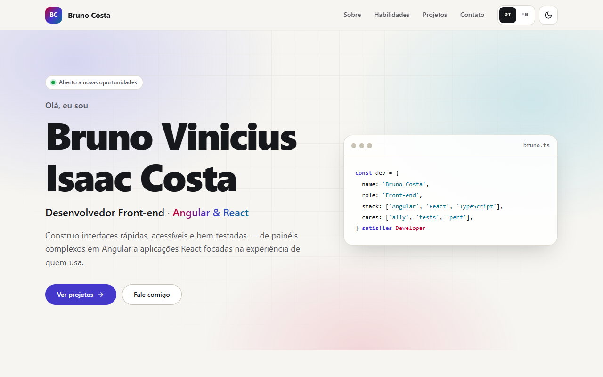

# Bruno Costa — Portfolio

> **Português:** [README.md](./README.md) (full documentation)

Personal site of **Bruno Vinicius Isaac Costa**, front-end developer (Angular & React). A fast,
accessible single page with an about section, skills and a filterable showcase of my open source
projects — each one linking to its source code and its live demo on GitHub Pages.

**Live demo:** https://brunoicosta.github.io/



## Highlights

- Sections: hero, about, skills, projects (filter: All / Angular / React) and contact.
- **Bilingual (pt-BR / EN)**: initial language = saved choice > browser language (`pt*` → pt-BR,
  otherwise en) > pt-BR; PT/EN switcher in the header; `<html lang>`, page title and meta description
  follow the active language. Project cards show a "PT-BR / EN" badge.
- Light/dark theme (OS preference on first visit, then remembered), applied before first paint.
- Project cards with tech badges, "Code"/"Demo" links and a screenshot loaded from each repo's
  `docs/screenshot.png`, with a skeleton while loading and a branded fallback when it is missing.
- Accessibility: skip link, semantic landmarks, visible focus, `aria-pressed` toggles, `role="status"`
  announcements, AA contrast in both themes, `prefers-reduced-motion` support.
- SEO: meta description, canonical, Open Graph/Twitter card image, JSON-LD, sitemap and robots.txt.

## Stack

React 19.3 · TypeScript 6.0 (strict) · Vite 8.3 · CSS Modules + design tokens · Motion 14 (LazyMotion) ·
Vitest 5 + Testing Library · ESLint 10 + typescript-eslint 8 · Prettier 3 · GitHub Actions + Pages.

## Internationalization in short

Typed dictionaries in `src/core/i18n/translations.ts`: pt-BR defines the `Dictionary` type and English
must match it exactly, so a missing key is a compile error. Data content uses `Localized<string>`.
No i18n library is needed for ~80 strings, which keeps the bundle small. To add a language, extend
`LANGUAGES`/`LANGUAGE_LABELS`, add a dictionary and fill the `Localized` fields — the compiler lists
everything that is missing.

## Running locally

```bash
npm install
npm run dev     # http://localhost:5173
npm test        # Vitest
npm run lint
npm run build   # type-check + production build
```

## Author

**Bruno Vinicius Isaac Costa** — https://github.com/BrunoICosta · [LinkedIn](https://www.linkedin.com/in/bruno-vin%C3%ADcius-isaac-costa-a90758156/) · brunoisaacosta@hotmail.com

License: [MIT](./LICENSE)
