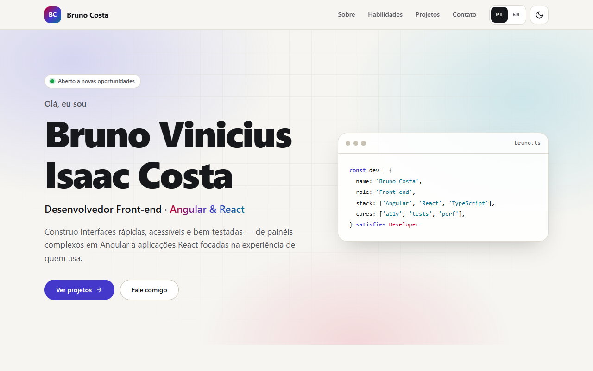

# Bruno Costa — Portfólio

> **English:** [README.en.md](./README.en.md)

Site pessoal de **Bruno Vinicius Isaac Costa**, desenvolvedor front-end (Angular & React). Uma página
única, rápida e acessível que apresenta quem sou, minhas habilidades e uma vitrine filtrável dos meus
projetos open source — cada um com link para o código e para a demo ao vivo. Feito com React 19,
TypeScript e Vite, sem framework de CSS e com animações discretas. Este repositório também é o
**agregador de deploy**: publica o portfólio e os 11 apps em um único Worker da Cloudflare.

**Demo ao vivo:** https://portfolio.brunoisaac.dev/



## Funcionalidades

- **Hero, Sobre, Habilidades, Projetos e Contato** em uma página com navegação por âncoras e header fixo.
- **Bilíngue (pt-BR / EN)**: idioma inicial pela escolha salva > idioma do navegador > pt-BR, seletor com
  bandeiras (Brasil / EUA) no header e badge "PT-BR / EN" com bandeirinhas nos cards (todos os projetos também são bilíngues).
- **Tema claro/escuro**: segue o sistema operacional na primeira visita e lembra a escolha; aplicado
  antes da primeira pintura (sem "flash" de tema errado).
- **Projetos filtráveis** (Todos / Angular / React) com contagem anunciada para leitores de tela.
- **Cards de projeto** com descrição, badges de tecnologia, links "Código" e "Demo" e screenshot carregado
  de `docs/screenshot.png` de cada repositório — com _skeleton_ durante o carregamento e um placeholder
  elegante quando a imagem ainda não existe.
- **Contato** por e-mail (`mailto:` + botão "copiar e-mail" com feedback) e GitHub. O link do LinkedIn
  fica oculto enquanto a constante `LINKEDIN_URL` estiver vazia.
- **Acessibilidade**: skip link, landmarks e headings semânticos, foco visível, `aria-pressed` nos
  filtros, avisos via `role="status"`, contraste AA nos dois temas e respeito a `prefers-reduced-motion`.
- **SEO**: meta description, canonical, Open Graph/Twitter Card com imagem 1200×630, JSON-LD (`Person`),
  `robots.txt`, `sitemap.xml`, manifest e favicons.

## Stack

| Área             | Tecnologia                                                                |
| ---------------- | ------------------------------------------------------------------------- |
| UI               | React 19.3, TypeScript 6.0 (strict)                                       |
| Build/dev server | Vite 8.3 + @vitejs/plugin-react 6.1                                       |
| Estilos          | CSS Modules + design tokens em CSS custom properties                      |
| Animações        | Motion 14 (`motion/react`, ex-Framer Motion) com `LazyMotion`             |
| Testes           | Vitest 5, Testing Library (React 16, user-event 14, jest-dom 7), jsdom 30 |
| Qualidade        | ESLint 10 + typescript-eslint 8 (strict), Prettier 3                      |
| CI/CD            | GitHub Actions                                                            |
| Hospedagem       | Cloudflare Workers (static assets) + Worker de fallback, Wrangler 4       |

## Arquitetura e decisões

- **Página única sem roteador.** O conteúdo é linear e cabe em uma página; âncoras (`#projects`) dão
  links compartilháveis sem o peso de um router.
- **`core` / `features` / `shared` / `data`.** `core` guarda infraestrutura (tema, i18n, storage),
  `features` tem uma pasta por seção, `shared` reúne componentes genéricos e `data` concentra o
  conteúdo tipado (`projects.ts`, `skills.ts`, `profile.ts`). Para adicionar um projeto basta incluir
  um objeto em `src/data/projects.ts` — o TypeScript garante descrição nos dois idiomas.
- **i18n próprio e tipado em vez de uma biblioteca.** Veja [Internacionalização](#internacionalização).
- **CSS Modules + tokens.** Cores, espaçamentos, raios e sombras são variáveis CSS; o tema escuro só
  redefine os tokens em `[data-theme='dark']`. Sem runtime de CSS-in-JS e sem classes utilitárias.
- **Animações com custo baixo.** `LazyMotion` + componentes `m` com as _features_ de animação carregadas
  em um chunk separado depois da primeira renderização; o `h1` (LCP) não é animado. `MotionConfig
reducedMotion="user"` desliga transformações para quem prefere menos movimento.
- **Screenshots com degradação elegante.** As imagens vêm do `raw.githubusercontent.com` de cada
  repositório, com `loading="lazy"`, dimensões fixas (sem layout shift) e fallback em caso de 404.
- **Preferências resilientes.** Leitura/escrita do `localStorage` nunca lança erro (modo privado,
  cookies bloqueados); um script inline no `index.html` aplica tema antes do React montar.

## Internacionalização

O site inteiro existe em **pt-BR** (padrão) e **inglês**: textos visíveis, `aria-label`s, títulos,
mensagens de estado (filtro, cópia de e-mail), `document.title` e a meta description.

**Como funciona**

- `src/core/i18n/translations.ts` tem um dicionário por idioma. O pt-BR é a fonte da verdade e define
  o tipo `Dictionary`; o inglês é declarado como `const en: Dictionary`, então qualquer chave faltando
  ou sobrando é erro de compilação (e um teste compara as chaves dos dois idiomas).
- Textos com variáveis são funções tipadas, ex.: `projects.count(n)` → "1 projeto" / "5 projetos".
- Conteúdo de dados usa `Localized<string>` (`{ 'pt-BR': …, en: … }`) — por exemplo a descrição de cada
  projeto em `src/data/projects.ts` — ou `Translatable` quando o texto pode ser neutro ("TypeScript").
- O `I18nProvider` expõe `{ language, t, setLanguage }` via `useI18n()` e sincroniza
  `<html lang>`, `document.title` e a meta description sempre que o idioma muda.
- **Idioma inicial:** escolha salva (`localStorage`, chave `bc-lang`) > idioma do navegador
  (`pt*` → pt-BR, qualquer outro → en) > pt-BR. Um script inline no `index.html` aplica o mesmo
  `<html lang>` antes do React montar.
- O seletor do header é um grupo ("Idioma"/"Language") de dois botões com bandeiras em SVG inline
  (`src/shared/components/Flag.tsx`; emoji de bandeira não renderiza no Windows). Cada botão tem
  `aria-pressed`, nome acessível e `title` no próprio idioma ("Português (Brasil)", "English") e
  atributo `lang`; a bandeira é decorativa (`aria-hidden`). O idioma ativo ganha anel de destaque e cor
  plena (não depende só de cor); os inativos ficam esmaecidos até receber hover/foco.
- Datas/números: hoje o único valor formatado é o ano do rodapé; novos valores devem usar
  `Intl.*Format(language)`.

**Por que não i18next?** Com ~80 strings e dois idiomas, um dicionário tipado entrega a mesma segurança
(chaves verificadas pelo compilador) sem dependência extra, sem carregamento assíncrono e sem custo no
bundle — o que ajuda a manter o Lighthouse perto de 100. Se o site crescer (namespaces, pluralização
complexa, muitos idiomas), migrar para i18next é direto: os dicionários já são objetos aninhados.

**Como adicionar um idioma (ex.: espanhol)**

1. Inclua o código em `LANGUAGES` e um rótulo em `LANGUAGE_LABELS` (`src/core/i18n/language.ts`) e ajuste
   `detectBrowserLanguage` (ex.: `es*` → `es`).
2. Crie `const es: Dictionary = { … }` em `translations.ts` e registre em `translations` — o compilador
   aponta tudo o que falta.
3. Adicione a chave `es` aos campos `Localized` em `src/data/` (o TypeScript também aponta).
4. Atualize o script inline do `index.html` e rode `npm test`.

## Deploy

Publicado na **Cloudflare (Workers static assets)** em https://portfolio.brunoisaac.dev/, em um
**único deploy** que contém o portfólio e todos os apps:

```
https://portfolio.brunoisaac.dev/          -> este portfólio (dist/)
https://portfolio.brunoisaac.dev/<repo>/   -> cada app de apps.json (build com base /<repo>/)
```

**Como funciona**

1. `apps.json` lista os apps: `{ "repo", "build": "npm run build:cf", "out" }`. `out` é a pasta gerada
   pelo build (`dist/<projeto>/browser` no Angular, `dist` no Vite, `out` no Next.js,
   `apps/web/dist` no monorepo do chat).
2. `scripts/assemble.mjs` monta `site/`: o portfólio na raiz, cada app em `site/<repo>/` e um
   `_headers` com `X-Content-Type-Options`, `Referrer-Policy` e cache longo (`immutable`) para os
   arquivos com hash (`/assets/*`, `/<app>/assets/*`, `/<app>/_next/static/*`).
3. `wrangler.jsonc` publica `site/` como static assets do Worker `portfolio` no custom domain
   `portfolio.brunoisaac.dev`. Arquivos existentes são servidos direto pela Cloudflare; só o que
   **não** existe chega ao Worker (`worker/index.ts`).
4. O Worker aplica as regras de `worker/routing.ts` (função pura, testada com Vitest):
   - `/<app>` sem barra: **301** para `/<app>/`;
   - `/<app>/arquivo.ext` inexistente: **404** em texto puro (nunca HTML no lugar de JS/CSS);
   - `/<app>/<rota>`: `index.html` do app com **200** (SPA). O `next-ecommerce-store`, que exporta
     HTML real por rota, responde com o próprio `404.html` e status **404** (`"fallback": "404"`);
   - qualquer outro caminho: `404.html` do portfólio com status **404**.

**Pipeline** (`.github/workflows/deploy.yml`): roda em push na `main`, manualmente
(`workflow_dispatch`), via `repository_dispatch` (`app-updated`) e diariamente (06:17 UTC).

1. `setup` lê `apps.json` e gera a matriz;
2. `apps` (matriz, `fail-fast: false`): checkout de `BrunoICosta/<repo>` (público, sem token), Node 22,
   `npm ci`, build e upload do `out` como artefato `app-<repo>`;
3. `site`: testes e build do portfólio (artefato `portfolio`);
4. `deploy` (concurrency `cloudflare-deploy`): só roda se **todos** os builds passaram; baixa os
   artefatos, executa `node scripts/assemble.mjs --artifacts artifacts` e `npx wrangler@4 deploy`.

**Secrets necessários** (Settings > Secrets and variables > Actions):

- `CLOUDFLARE_ACCOUNT_ID`: ID da conta Cloudflare;
- `CLOUDFLARE_API_TOKEN`: token de conta criado a partir do template **Edit Cloudflare Workers**,
  limitado à conta e à zona `brunoisaac.dev`. Permissões mínimas: _Account > Workers Scripts > Edit_
  (o primeiro deploy cria o Worker), _Zone > Workers Routes > Edit_ (custom domain) e
  _Account > Account Settings > Read_.

**Adicionar um app**

1. No repositório do app, crie o script `build:cf` gerando o build estático com base `/<repo>/`.
2. Inclua `{ "repo": "<repo>", "build": "npm run build:cf", "out": "<pasta>" }` em `apps.json` (use
   `"fallback": "404"` só se o app exporta HTML por rota) e o caminho `"/<repo>"` em
   `assets.run_worker_first` no `wrangler.jsonc`; um teste garante que as duas listas batem.
3. Adicione o card em `src/data/projects.ts`.

**Redeploy disparado por um app**: o workflow do app pode chamar, ao final do CI na `main`:

```yaml
- run: >-
    gh api repos/BrunoICosta/portfolio/dispatches
    -f event_type=app-updated -f "client_payload[repo]=${{ github.event.repository.name }}"
  env:
    # PAT fine-grained com acesso ao repositório "portfolio" e Contents: Read and write
    GH_TOKEN: ${{ secrets.PORTFOLIO_DISPATCH_TOKEN }}
```

**Testar localmente** (sem login na Cloudflare):

```bash
# usa os builds em ../<repo>/<out> (ou em outra pasta com --repos <dir>)
node scripts/assemble.mjs --only react-recipe-finder,next-ecommerce-store
npx wrangler@4 dev   # http://localhost:8787
```

## Como rodar

Pré-requisitos: Node.js 22+ e npm 10+.

```bash
npm install          # instala as dependências
npm run dev          # servidor de desenvolvimento em http://localhost:5173
npm test             # testes unitários e de componentes (Vitest, uma execução)
npm run test:watch   # testes em modo watch
npm run lint         # ESLint
npm run format:check # Prettier (use `npm run format` para corrigir)
npm run build        # type-check + build de produção em dist/
npm run preview      # serve o build de produção localmente
npm run assemble     # monta site/ (portfólio + apps) para o deploy na Cloudflare
npm run cf:dev       # Worker + assets localmente com wrangler dev
```

## Estrutura de pastas

```
├── apps.json                # apps publicados em /<repo>/ (repo, build, out)
├── wrangler.jsonc           # Worker "portfolio", static assets e custom domain
├── worker/                  # Worker de fallback (index.ts) e regras puras testadas (routing.ts)
├── scripts/assemble.mjs     # monta site/ a partir dos builds
├── index.html               # meta tags/SEO, JSON-LD e script de tema pré-render
├── public/                  # favicon, og-image, 404.html, robots.txt, sitemap.xml, manifest
└── src/
    ├── core/
    │   ├── i18n/            # dicionários pt-BR/en, provider, hook useI18n
    │   ├── theme/           # tema claro/escuro, provider, hook useTheme
    │   ├── sections.ts      # ids das seções (âncoras)
    │   └── storage.ts       # localStorage seguro
    ├── data/                # profile.ts, projects.ts, skills.ts (conteúdo tipado)
    ├── features/            # header, hero, about, skills, projects, contact, footer
    ├── shared/
    │   ├── components/      # Section, ButtonLink, ExternalLink, Icon
    │   ├── hooks/           # useCopyToClipboard
    │   └── motion/          # MotionProvider, Reveal, variants
    ├── styles/              # tokens.css e global.css
    └── test/                # setup do Vitest e render com providers
```

## Próximos passos

- Pré-renderizar o HTML (SSG) para entregar o conteúdo já no primeiro byte.
- Buscar estrelas e data do último commit de cada repositório pela API pública do GitHub.
- Página de detalhes por projeto com GIFs/vídeos curtos das demos.
- Preencher `LINKEDIN_URL` em `src/data/profile.ts`.

## Autor

**Bruno Vinicius Isaac Costa** — https://github.com/BrunoICosta · [LinkedIn](https://www.linkedin.com/in/bruno-vin%C3%ADcius-isaac-costa-a90758156/) · brunoisaacosta@hotmail.com

## Licença

[MIT](./LICENSE)
